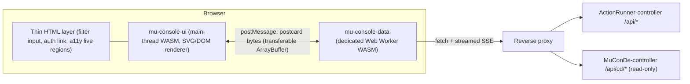

# MuConsole Design Specification

MuConsole is the unified console for **ActionRunner** (continuous integration), **MuConDe** (continuous delivery), **MuRegist**, **MuObserve**, and **Jero**. Its architecture centers on four pillars:

- **`HtmlCoreSkin` (default) and `WireframeSkin` (active-session optional)**: Skin-agnostic `ConsoleScene` and `DialogModel` projected across high-contrast accessible HTML/DOM chrome (`HtmlCoreSkin`) and crisp filter-free dark-slate (`#0e1116`) CRT SVG (`WireframeSkin`).
- **Role-gated 8-Area Architecture**: Fail-closed cold boot, mandatory 0-Passkey post-login gate, timed walk-by role elevation (`+role[MM:SS][MM:SS]`), `Dashboard`, `CI`, `CD`, `A|B Deploy`, `Observe`, `Repository`, `Model-Runner`, and `Platform`.
- **Two-Module WebAssembly Split**: A UI module (`mu-console-ui`) on the main thread and a folio-gating data module (`mu-console-data`) in a dedicated Web Worker.
- **Zero-Overflow Layout**: Across desktop viewports (14" laptop and wider) and mobile viewports (phone portrait and compact landscape), enforced natively by `mu-console-layout`.

## 1. Target Viewports & Scroll Budget

| Device                          | CSS viewport | Usable canvas (design target)                                | Notes                                             |
| ------------------------------- | ------------ | ------------------------------------------------------------ | ------------------------------------------------- |
| 14" laptop (default scaling)    | 1512×982     | **1512×860** (browser toolbar + tab bar)                     | Fullscreen / PWA gets about 1512×944              |
| 14" laptop ("More Space")       | 1800×1169    | 1800×1040                                                    | The layout grows; no new breakpoint               |
| Phone portrait (402×874 pt, 3×) | 402×874      | **402×≈720** in the browser, **402×778** as an installed PWA | Safe areas ≈ 62 pt top, 34 pt bottom              |
| Phone landscape                 | 874×402      | 874×≈340                                                     | Compact layout: rail on the left, no carousel row |

> [!IMPORTANT]
> **Invariant: zero page-level scroll.** `html, body { overflow: hidden; height: 100dvh }`. Overflow inside a panel uses **panel-local paging** (pager plus keyboard / swipe), not scrollbars. Exceptions: the log viewer and the repo-picker list, which use virtualized panel scrolling.

Mobile toolbar heights change as browser chrome collapses, so the solver uses the live `visualViewport` size (`Viewport::from_visual_viewport`) instead of hard-coded heights.

## 2. Architecture

| Crate                 | Path            | Target        | Licence                                       | Responsibility                                                                                     |
| --------------------- | --------------- | ------------- | --------------------------------------------- | -------------------------------------------------------------------------------------------------- |
| `mu-console-protocol` | `code/protocol` | native + wasm | LGPL-3.0-only WITH LGPL-3.0-linking-exception | `UiCommand` / `DataEvent`, view models, postcard codec, protocol version                           |
| `mu-console-theme`    | `code/theme`    | native + wasm | LGPL-3.0-only WITH LGPL-3.0-linking-exception | Wireframe tokens, Nerd icon glyph table, font metrics, dependency-free SVG writer, `WireframeSkin` |
| `mu-console-layout`   | `code/layout`   | native + wasm | LGPL-3.0-only WITH LGPL-3.0-linking-exception | Pure solver `solve(viewport, safe_area, area, font) -> Frames`, tested natively for no overflow    |
| `mu-console-ui`       | `code/ui`       | wasm (main)   | AGPL-3.0-only                                 | Root `<svg>` renderer, HTML shell, components, router, input handling                              |
| `mu-console-data`     | `code/data`     | wasm (worker) | AGPL-3.0-only                                 | Fetching, SSE parsing, normalized store, diffing, coalescing (≤ 10 Hz), offline cache              |

### 2.1 Worker protocol

- **UI → Data**: `Subscribe(Route)`, `SelectRepo { repo, submodule }`, `Page { panel, cursor }`, `Retry`, `SetVisibility { hidden }`, `SetCrtFont(font)`. When the tab is hidden, the worker throttles to heartbeat-only.
- **Data → UI**: `Snapshot(ViewModel)`, `Patch(Vec<Delta>)`, `Connection(ConnState)`, `Error(UiError)`.
- Frames are `varint(u32 protocol version) ++ postcard(body)` in transferable `ArrayBuffer`s. A version mismatch is reported as `UiError::VersionMismatch` and shown as a reload banner.
- SSE runs on `fetch` + `ReadableStream` inside the worker with a hand-written line parser, avoiding `EventSource`-in-worker differences between engines.

### 2.2 Rendering model (`WireframeSkin` SVG + HTML Shell)

- One root `<svg>` sized to the viewport inside `#muconsole-dashboard`. Every component is an SVG `<g>` placed at a frame solved by `mu-console-layout`.
- The HTML accessibility shell (`#muconsole-shell`, `#muconsole-header`) carries the skip-link, the `16px` repo/log filter input (`#muconsole-filter`), operator authentication link (`#muconsole-auth-link`), and `aria-live` status regions (`#muconsole-aria-polite`, `#muconsole-aria-assertive`).
- Each interactive component `<g>` exposes `data-control-id`, bounding-box metadata (`data-bbox-w`, `data-bbox-h`), `role`, `aria-label`, and `<title>`.
- Keyboard shortcuts: `[` / `]` switch area; `←` / `→` move the carousel; `/` focuses the filter/selector; `Esc` goes up one breadcrumb level.
- Dark wireframe is the active visual baseline in Milestone 1, with `HtmlCoreSkin` HTML-first rendering arriving in Milestone 2.

## 3. `WireframeSkin` Theme & Typography

`WireframeSkin` uses crisp vector boxes, hairline borders, and filter-free SVG primitives (`<rect>`, `<line>`, `<path>`, `<circle>`, `<text>`) without SVG `<filter>` shaders, ensuring deterministic, lightweight rendering across desktop and mobile browsers.

### 3.1 Colour & semantic tokens

| Role                | Token               | Value     | CSS Variable         |
| ------------------- | ------------------- | --------- | -------------------- |
| Dark slate / canvas | `wireframe.canvas`  | `#0e1116` | `--bg-canvas`        |
| Panel background    | `wireframe.panel`   | `#141922` | `--bg-panel`         |
| Screen surface      | `wireframe.screen`  | `#090c10` | `--bg-screen`        |
| Control surface     | `wireframe.control` | `#1b2230` | `--bg-control`       |
| Hairline border     | `wireframe.border`  | `#2b3440` | `--border-wireframe` |
| Neon cyan accent    | `chrome.neon_cyan`  | `#00f0ff` | `--accent-neon-cyan` |
| Live green glow     | `chrome.green_glow` | `#4dff7a` | `--color-green-glow` |
| Primary text        | `wireframe.text`    | `#e6edf3` | `--text-primary`     |
| Muted text          | `wireframe.muted`   | `#8b949e` | `--text-muted`       |
| Pass / healthy      | `wireframe.pass`    | `#33f08a` | `--status-pass`      |
| Warn / staging      | `wireframe.warn`    | `#ffb43a` | `--status-warn`      |
| Fail / error        | `wireframe.fail`    | `#ff4d4d` | `--status-fail`      |
| Info / running      | `wireframe.info`    | `#5fb3ff` | `--status-info`      |

**State encoding:** filled signal = passed, active border/indicator = running, failed indicator + semantic fail stroke = failed, hollow signal = pending, dashed track = merge pending or unmerged branch siding. State indicators always combine symbol/shape and label with colour so status never relies on colour alone.

### 3.2 Typography (Nerd Font families, self-hosted and subsetted)

| Role                                  | Family (Nerd Fonts v3.5.1)            | Licence (as shipped)         | Loading Policy            |
| ------------------------------------- | ------------------------------------- | ---------------------------- | ------------------------- |
| Console text (default)                | Hurmit Nerd Font Mono, Regular + Bold | SIL OFL 1.1                  | `font-display: block`     |
| Console text (dyslexia accessibility) | OpenDyslexicM Nerd Font Mono, Regular | Bitstream Vera–style licence | Lazy-loaded when selected |

- **Nerd icons** (branch `U+E0A0`, server `U+F233`, git-repo `U+F418`, bolt `U+F0E7`, check `U+F00C`, cross `U+F00D`, warning `U+F071`, and additional CI/CD symbols) live in `mu_console_theme::glyphs`, which drives `mu-console-subset-unicodes -- crt`. `scripts/fetch-fonts.sh` fails closed when a required code point is missing from a subset.
- **Font selector:** toggles between `Hurmit` (`HRMT`) and `OpenDyslexicM` (`DYSLX`), persisted in `localStorage` and synchronized with the worker via `UiCommand::SetCrtFont`.
- **Metric-aware layout:** advance widths are tracked in `mu_console_theme::metrics` (`HURMIT` `0.618 em`, `OPEN_DYSLEXIC` `0.732 em`). Each text panel derives `size = column_px / advance_em`, keeping column counts fixed without layout reflow when toggling fonts. Floors: `12 px` desktop, `13 px` phone; excess text truncates cleanly with `…`.

> [!WARNING]
> Font binaries are never committed. Subsets preserve each family's shipped licence in `dist/fonts/` and use the Nerd Fonts family names (`Hurmit`, `OpenDyslexicM`), not the reserved name "Hermit".

## 4. Layouts

### 4.1 Desktop (1512×860 canvas)

- Left rail (`80 px` wide) renders C1 Area navigation (`OVR`, `CI`, `CD`, `OBS`, `FLT`), font toggle, and status counters.
- Top header (`#muconsole-header`, `48 px`) + C2 breadcrumb bar display the active `#/{area}/{owner}/{repo}/{branch}/{job}/{stage}` trail and health badges.
- Carousel row holds three scorecard panels (`192 px` height on `Wide`), paging control, and C3 Repository / Submodule stepper.
- Dashboard row splits C5 Trainway (`898 px`) and C6 Delivery / IT gate (`506 px`) side by side, scaling cleanly down to compact heights without root-page scrollbars.

### 4.2 Phone portrait (402×720–778)

- Top bar (`44 px` + safe-area top inset) shows the collapsed breadcrumb and repo picker trigger.
- Single-card carousel (`168 px`) with page indicator and swipe/button navigation.
- Dashboard panel fills remaining vertical space with swipe/tab switching between Trainway and Delivery.
- Bottom rail (`60 px` + safe-area bottom inset) exposes compact Area controls (`>= 44×44 pt` touch targets).

### 4.3 Breakpoints (solver, not CSS)

| Class              | Condition                    | Area nav         | Carousel                               | Dashboard                          |
| ------------------ | ---------------------------- | ---------------- | -------------------------------------- | ---------------------------------- |
| `Wide`             | w ≥ 1280 and h ≥ 760         | Left rail (80)   | 3 cards + carousel controls + selector | Trainway + Delivery side by side   |
| `Medium`           | otherwise (w ≥ 520, h ≥ 480) | Left rail (80)   | Up to 2 cards + selector               | Trainway + collapsed Delivery      |
| `CompactLandscape` | h < 480                      | Left rail (72)   | Hidden                                 | Trainway / Delivery as pages       |
| `Phone`            | w < 520                      | Bottom nav strip | 1 card, paged                          | Trainway / Delivery as paged views |

## 5. Components

| #   | Component                      | Behaviour                                                                                                      | Data                                |
| --- | ------------------------------ | -------------------------------------------------------------------------------------------------------------- | ----------------------------------- |
| C1  | Area navigation                | Selector positions: Overview, CI, CD, Observe, Fleet. Exactly one active. Keyboard `[` / `]`.                  | `DataEvent` alert badges            |
| C2  | Breadcrumb                     | Built from `#/{area}/{owner}/{repo}/{branch}/{job}/{stage}`; `Esc` moves up; legacy `#/jobs/{id}` redirects    | Router                              |
| C3  | Repository & submodule stepper | Outer = repo, inner = submodule; drives breadcrumb, carousel, Trainway and Delivery                            | `/api/repos`, topology, `/api/cd/*` |
| C4  | Scorecard carousel             | Twin-metric panel per repo, paged by prev/next controls, `←` / `→` keys, or swipe                              | `RepoScore`                         |
| C5  | Trainway (CI)                  | Railway view of branches, sidings, stage stations, running jobs, and guarded job restart (`c5-restart-switch`) | Topology + job / stage SSE          |
| C6  | Delivery IT gate (CD)          | Live integration-test checkpoint track, gate promote/rollback status, and log excerpt pager                    | Deployment gate + IT progress SSE   |

### 5.1 Trainway

- **Main line:** default branch (`main`). **Stations:** pipeline stages from `.actionrunner` (`PUSH → FMT → CLIPPY → AUDIT → COV → BENCH → RELEASE → MERGE`). **Sidings:** `feat/**` branches and open PRs curving off the fork point and rejoining at `MERGE`. **Trains:** CI jobs tagged with worker nodes (`NODE-A`, `WORKER-RV64`).
- Lanes are assigned deterministically as a pure function of repository topology, fitting `main` + 4 sidings on desktop (`main` + 2 on phone) with overflow summarised as `YARD +N`.

### 5.2 Delivery: integration-test gate

- Header displays service name, artifact digest, target node, staged slot, lease TTL, and aggregate checkpoint progress.
- Checkpoint track displays each contract test with `[C]` critical indicator, pass/running/pending/fail state, duration, and interactive log excerpt paging.
- Status indicators summarize `PROMOTED`, `STAGING`, `ROLLBACK`, and `TAINT`.

## 6. Build, Caching & Deployment

- `scripts/build-dist.sh` builds both WASM modules (`mu-console-ui` on the main thread and `mu-console-data` in the dedicated Web Worker), copies `tokens.css` and the subsetted `dist/fonts/*.woff2` bundle, and injects content-hash `?v=<hash>` query parameters into `dist/index.html` and `dist/muconsole-data_loader.js`.
- Reverse proxy (`nginx/muconsole.conf`): `no-cache, no-store, must-revalidate` on the HTML entry point; `etag on` plus `no-cache, must-revalidate` on WASM / JS / CSS / WOFF2 assets.
- **Parallel dedicated-host deployment**:
  - `MuConsole` is hosted at `/` on `https://console.lma1980.duckdns.org` in parallel with `ActionRunner-web` on `https://hook.lma1980.duckdns.org`.
  - The GitHub webhook ingress (`POST /webhook`) permanently remains exclusively on `https://hook.lma1980.duckdns.org` (`console.lma1980.duckdns.org` returns `404` on `/webhook`).

## 7. Verification

- **Layout (native):** `cargo test -p mu-console-layout` verifies target viewports × areas × CRT fonts (plus size sweeps) stay inside the canvas without overlap or overflow.
- **Protocol:** `cargo test -p mu-console-protocol` verifies postcard round-trips and version/discriminant rejection.
- **Theme:** `cargo test -p mu-console-theme` verifies `WireframeSkin` SVG well-formedness, determinism, zero `<filter>` usage, and `tokens.css` drift checks.
- **UI & Freshness:** `cargo test -p mu-console-ui --test ux_gate` validates viewport bounds, mobile touch targets (`>= 44×44`), `16 px` input font size, auth/restart gating, and `u24_dist_freshness_and_submodule_alignment`.
- **WASM & Pre-PR gate:** `cargo fmt --all -- --check` → `./scripts/format_docs.sh --check` → `cargo clippy --workspace --all-targets -- -D warnings` → `cargo test --workspace` → Miri (`cargo +nightly miri test --workspace --lib`) → `cargo build --target wasm32-unknown-unknown`.
